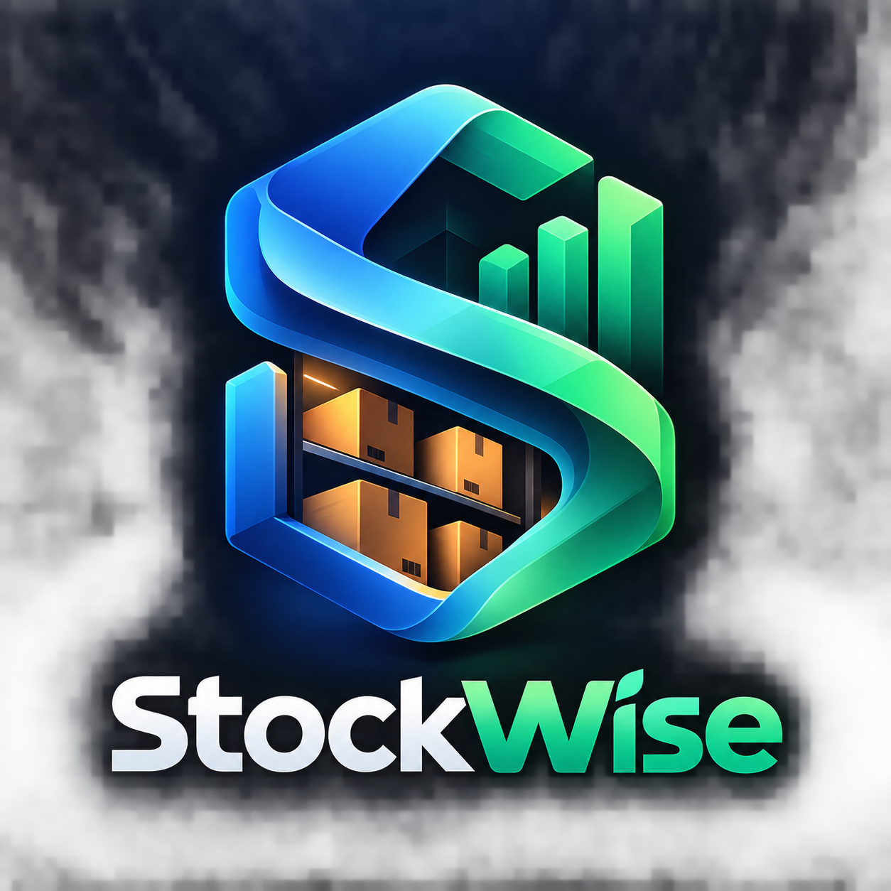
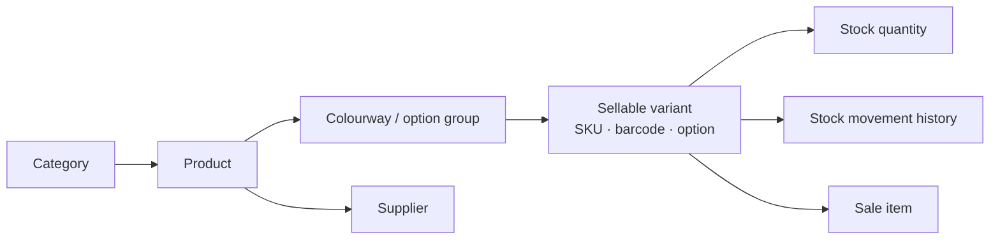
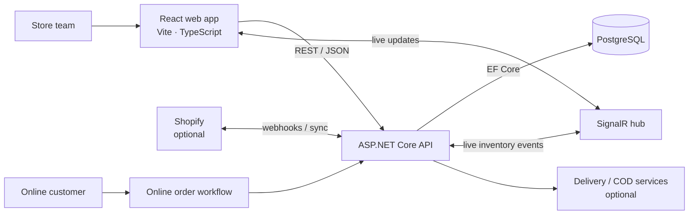
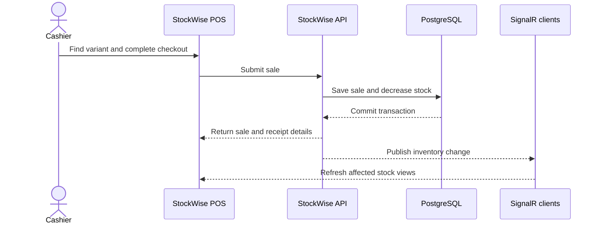

<div align="center">
  

  # StockWise

  **One workspace for the shop floor, stockroom, and online orders.**

  A configurable retail and inventory platform for clothing, shoes, fragrance, beauty, home goods, electronics, and other product businesses.

  [Watch the product demo](https://www.youtube.com/watch?v=yp-GLmBXSqM) · [Quick start](#quick-start) · [Features](#what-stockwise-does) · [Deployment](#deployment)

  
  
  
  
  
</div>

---

## Product demo

[](https://www.youtube.com/watch?v=yp-GLmBXSqM)

StockWise keeps in-store and online operations connected. Product variants, stock changes, sales, and customer records live in the same system, so teams can follow a consistent workflow from receiving goods to fulfilling an order.

## What StockWise does

### Local store

- Point of sale with product search, barcode workflows, cart management, checkout, and printable receipts.
- Product catalogue with categories, brands, suppliers, SKUs, barcodes, prices, and flexible variants.
- Stock levels, reorder thresholds, adjustments, and a movement history for auditability.
- Sales history, refunds, reports, customers, QR identification, and configurable loyalty points.
- Supplier purchasing and invoices, including receiving stock and tracking payments.
- Receipt and invoice designers, thermal-printer tools, and configurable store settings.

### Online operations

- Online product catalogue and order queue with order status, shipping, and fulfillment workflows.
- Online dashboard, finance summaries, delivery management, customer records, and operational reports.
- Order confirmation queue with reusable WhatsApp message templates.
- Shopify connection and synchronization tools when a store is configured.
- Cash-on-delivery finance and Ozon Express integration settings where credentials and service access are available.

### Administration

- Role-based access for administrators, cashiers, and stock managers, with section permissions.
- Admin health information, audit history, database backup and restore, and system settings.
- SignalR notifications for live inventory updates in connected screens.
- A product landing page with an interactive WebGPU Glass Fractal / orb hero effect when supported by the browser.

> Integrations that require third-party credentials are optional. The demo seed does not connect Shopify, WhatsApp, Ozon Express, or a payment provider automatically.

## A flexible catalogue

StockWise models products independently from their sellable variants. A business can use colourways and sizes for apparel, bottle volumes for fragrance, capacities for homeware, or a simple standard option for products that do not need variants.



The data model does not require a shoe size or any particular product category. Variant options are normal catalogue data and can be managed through the application.

## How the parts fit together





## Technology

| Area | Technology |
| --- | --- |
| Web client | React 19, TypeScript, Vite, Tailwind CSS, Motion |
| API | ASP.NET Core 10, C#, REST controllers, SignalR |
| Persistence | PostgreSQL 16, Entity Framework Core migrations |
| Authentication | JWT bearer tokens and role/section authorization |
| Local development | Windows batch launchers or separate API/frontend commands |
| Production deployment | Docker Compose, PostgreSQL, Caddy reverse proxy, HTTPS |

## Quick start

### Windows demo

1. Install the [.NET 10 SDK](https://dotnet.microsoft.com/download), [Node.js 18 or later](https://nodejs.org/), and Docker Desktop if you want to use the local PostgreSQL container.
2. Clone the repository and open its root folder.
3. Configure a PostgreSQL connection with .NET User Secrets. The local Docker database listens on `localhost:5433`. To use Aiven or another hosted PostgreSQL instance, put its connection string in User Secrets instead. See [Database configuration](#database-configuration).
4. Double-click `start-demo.bat`.

The launcher starts the local PostgreSQL container when Docker is available, then runs the API and Vite frontend. If Docker is unavailable, it tries the database configured in app settings or .NET User Secrets. The demo seed runs only when the product catalogue is empty.

| Service | Local address |
| --- | --- |
| Web application | [http://localhost:5173](http://localhost:5173) |
| API health | [http://localhost:5001/api/health](http://localhost:5001/api/health) |
| Swagger (Development) | [https://localhost:7001/swagger](https://localhost:7001/swagger) |
| Local PostgreSQL | `localhost:5433` |

### Windows without demo data

Run `start.bat` to start the API and frontend with `DemoData:Enabled=false`. This prevents new sample catalogue data from being added. It does **not** remove demo records already in the database. Use a fresh database when you need a clean non-demo workspace.

### Manual development startup

Start PostgreSQL first. From the repository root:

```powershell
# Start the local development database (Docker Desktop must be running)
docker compose up -d postgres

# Configure local development secrets once (the API project already has a User Secrets ID)
$jwt = [guid]::NewGuid().ToString() + [guid]::NewGuid().ToString()
dotnet user-secrets set "ConnectionStrings:Default" "Host=localhost;Port=5433;Database=StockManagement;Username=postgres;Password=postgres" --project src/SMS.API/SMS.API.csproj
dotnet user-secrets set "Jwt:SecretKey" $jwt --project src/SMS.API/SMS.API.csproj

# Terminal 1: API
cd src/SMS.API
dotnet restore
dotnet run

# Terminal 2: frontend
cd src/SMS.React
npm ci
npm run dev
```

The Vite development server proxies `/api`, `/hubs`, and `/uploads` to the API on port `5001`.

### Demo seed contents

On a genuinely empty product catalogue, the development seed creates a cross-category sample store, including:

- 16 products across apparel, accessories, fragrance and beauty, home and kitchen, electronics, stationery, and footwear.
- Product variants with sizes, colours, volumes, and other options; opening stock and examples below reorder level.
- 3 suppliers, 5 customers, and 40 dated sample sales.
- Stock movements and customer loyalty history that make dashboard, inventory, sales, and reporting screens useful immediately.

The seed is additive and exits when any product already exists. It does not overwrite an existing catalogue. Demo customer email addresses use reserved example/test domains.

### Demo accounts

| Username | Password | Role |
| --- | --- | --- |
| `admin` | `admin123` | Admin |
| `cashier` | `cashier123` | Cashier |
| `stock_manager` | `stock123` | Stock manager |

These are development-only starter credentials. Change them on first login and never use them for a public or production deployment.

## Database configuration

The API reads its connection string from `ConnectionStrings:Default`. Keep real credentials out of tracked JSON files, shell history, and commits. The API project already has a User Secrets ID; set the value with:

```powershell
dotnet user-secrets set "ConnectionStrings:Default" "Host=<host>;Port=<port>;Database=<database>;Username=<user>;Password=<password>;SSL Mode=Require;Trust Server Certificate=true" --project src/SMS.API/SMS.API.csproj
```

The local Docker database uses `StockManagement` / `postgres` / `postgres` on port `5433`. Those are local-only Docker defaults. Store the connection in User Secrets as shown above; replace it with your provider's connection string when using Aiven or another hosted database. Store a random JWT key in User Secrets too.

## Integrations and configuration

- **Shopify:** Configure the shop domain, app credentials, access token, webhook secret, and location ID. Keep Shopify disabled until valid credentials and webhook settings are in place.
- **WhatsApp:** Manage order-confirmation templates in the app. Sending requires the supported messaging configuration for your deployment.
- **Ozon Express / cash on delivery:** Configure credentials and service settings before enabling live delivery operations.
- **Printers and scanners:** Barcode scanners that act as keyboard input work with product search. Configure supported receipt or thermal printers in the printer and receipt settings.
- **Store settings:** Set the store name, contact information, receipt and invoice layouts, tax, loyalty rules, and online settings from the application.

Use .NET User Secrets for local development and deployment environment variables or a secret manager for production. Files such as `.env.prod`, `deploy/.env`, and local API settings are intentionally gitignored.

## API overview

API routes are rooted at `/api`. The API also exposes Swagger while running in Development.

| Area | Route | Purpose |
| --- | --- | --- |
| Authentication | `/api/auth` | Login, current user, and account operations |
| Products / catalogue | `/api/products`, `/api/categories`, `/api/colors`, `/api/sizes` | Catalogue and sellable options |
| Stock | `/api/stock` | Quantities, adjustments, and movement history |
| Sales | `/api/sales`, `/api/refunds` | Checkout history, reporting, and returns |
| Customers | `/api/clients` | Customer profiles and loyalty |
| Suppliers / purchasing | `/api/fournisseurs`, `/api/invoices` | Suppliers, purchase invoices, receiving, and payments |
| Online orders | `/api/online-orders`, `/api/order-confirmation` | Order management, statuses, and confirmations |
| Online operations | `/api/cod-finance`, `/api/whatsapp-templates` | COD tracking and message templates |
| Shopify | `/api/shopify`, `/api/shopify-products`, `/api/shopify-link` | Shopify status, catalogue, and synchronization |
| Administration | `/api/admin/users`, `/api/admin/roles`, `/api/admin/health`, `/api/admin/backup` | User access, health, audit, backup, and restore |
| Live updates | `/hubs/inventory` | SignalR inventory hub |
| Health | `/api/health` | API health endpoint |

Use the running Swagger UI for the exact request schemas and supported actions for your checked-out version.

## Project layout

```text
Stockwise/
├── src/
│   ├── SMS.Domain/             # Core entities and domain rules
│   ├── SMS.Application/        # Use cases, service contracts, DTOs, validation
│   ├── SMS.Infrastructure/     # PostgreSQL, EF Core, repositories, integrations
│   ├── SMS.API/                # ASP.NET Core API, auth, controllers, hubs
│   └── SMS.React/              # React application and Vite configuration
├── tests/
│   ├── SMS.Domain.Tests/
│   ├── SMS.Application.Tests/
│   └── SMS.API.IntegrationTests/
├── deploy/                     # VPS, Docker, backup, and deployment guides
├── tools/                      # Database backup and sync utilities
├── StockManagementSystem.sln
├── docker-compose.yml          # Development PostgreSQL / API / frontend stack
├── docker-compose.prod.yml     # Production PostgreSQL / API / Caddy stack
├── start-demo.bat              # Windows demo startup with additive demo seed
└── start.bat                   # Windows startup with demo seed disabled
```

## Build and tests

```powershell
# Build and run the .NET test suites
dotnet build StockManagementSystem.sln
dotnet test StockManagementSystem.sln

# Type-check and create a production frontend bundle
cd src/SMS.React
npm ci
npm run build
```

## Deployment

Production deployment uses `docker-compose.prod.yml`, PostgreSQL, the API container, and Caddy for HTTPS. Start from [`deploy/VPS-DEPLOY.md`](deploy/VPS-DEPLOY.md) and [`deploy/SETUP.md`](deploy/SETUP.md). Copy `.env.prod.example` to `.env.prod`, set a real domain and strong independent secrets, and keep `.env.prod` out of Git. Do not deploy the development defaults or demo accounts to a public server.

The development `docker-compose.yml` has convenience credentials and is not a production configuration. The production compose file does not publish the database port externally.

## Project documents

- [Architecture notes](ARCHITECTURE.md)
- [Deployment guide](deploy/VPS-DEPLOY.md)
- [Deployment setup and operations](deploy/SETUP.md)
- [Manual online-store verification script](manual-test-script-online-store.md)
- [Demo video](https://www.youtube.com/watch?v=yp-GLmBXSqM)

## License

No license file is currently included. All rights remain with the project owner unless a license is added.
